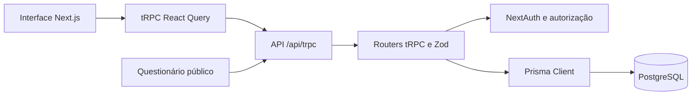
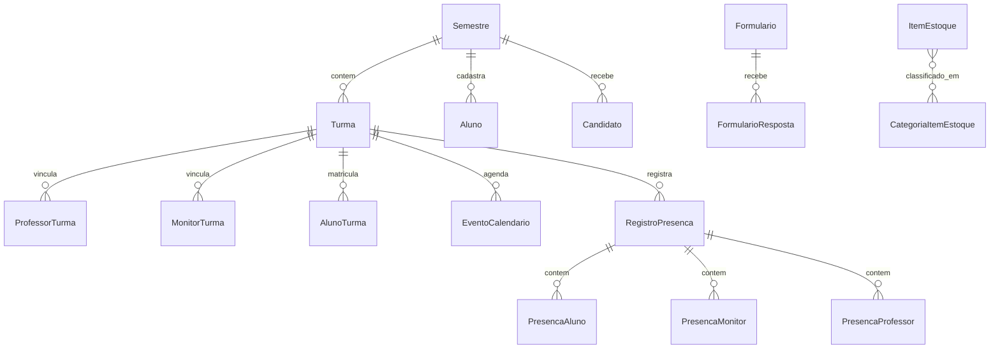

# Arquitetura do Nexus

## Visão geral

O aplicativo web usa Next.js App Router e React. As páginas consultam os routers por `src/trpc/react.tsx`; o handler em `src/app/api/trpc/[trpc]/route.ts` recebe as chamadas. As procedures validam entradas com Zod, verificam sessão/cargo/vínculo e usam o Prisma Client configurado em `src/server/db.ts`. O schema está em `prisma/schema.prisma`.

Autenticação por credenciais fica em `src/server/auth`, com sessão JWT do NextAuth e handler em `/api/auth/[...nextauth]`. `/api/uploadthing` atende aos uploads usados pela aplicação. A rota pública de questionário acessa apenas as procedures públicas do router `formulario`.

## Organização do código

| Caminho | Papel |
| --- | --- |
| `src/app/page.tsx` | Página institucional pública. |
| `src/app/nexus/layout.tsx` | Estrutura da área interna, sidebar e controle visual global. |
| `src/app/nexus/dashboard` | Lista e detalhe das turmas. |
| `src/app/nexus/diretoria` | Painel e páginas administrativas, protegidas pelo layout da diretoria. |
| `src/app/nexus/questionarios` | Rotas de questionários para usuários autorizados. |
| `src/app/questionarios/[slug]` | Resposta pública de questionário publicado. |
| `src/app/_components` | Navegação e componentes reutilizáveis. |
| `src/server/api/root.ts` | Registro dos routers tRPC. |
| `src/server/api/routers` | Regras de aplicação por domínio. |
| `src/server/auth` | Configuração de login, sessão e senhas. |
| `src/lib` | Utilitários de domínio e geração de documentos. |
| `generated/prisma` | Cliente Prisma gerado; regenerado a partir do schema. |
| `prisma/migrations` | Histórico SQL versionado. |

As telas grandes normalmente mantêm hooks e componentes próprios em `_components` junto à rota. Componentes de diretoria usados em mais de uma página ficam em `src/app/_components/diretoria`.

## Routers tRPC

| Router | Responsabilidade |
| --- | --- |
| `conta` | Senha da sessão e solicitações de redefinição. |
| `turma` | Turmas acessíveis ao usuário e conteúdo interno. |
| `diretoria` | Resumo, semestres, turmas, pessoas, presença, sorteio, impressão e atualização de materiais. |
| `aluno`, `professor`, `monitor`, `diretor` | Operações específicas de cadastro e gestão. |
| `formulario` | Gestão de questionários e endpoints públicos de resposta. |
| `certificado`, `declaracao` | Geração de certificados e declarações. |
| `estoque` | Itens, categorias e operações de estoque restritas à diretoria. |

`protectedProcedure` exige uma sessão. `directorProcedure` e `coordinatorProcedure` consultam o papel do usuário no banco. `turma` aplica verificações de vínculo e função em suas procedures. O router `formulario` permite também professores em questionários compartilhados, com regras de visibilidade/autoria próprias.

## Dados principais

- `User` representa coordenador, diretor, professor ou monitor; `Aluno` é um cadastro sem login.
- `Semestre` organiza turmas, alunos, sorteio, impressão e atualização de materiais. Uma turma pertence a um semestre; usuários podem se vincular a várias turmas.
- `RegistroPresenca` é único por turma e data. Tabelas específicas guardam o estado de alunos, monitores e docentes.
- `Formulario` guarda a definição em `conteudo` JSON; `FormularioResposta` guarda cada envio em `respostas` JSON.
- `ItemEstoque` tem `nome`, `qtd`, `validade` e relação muitos para muitos com `CategoriaItemEstoque`. O estoque não possui vínculo com semestre.

O schema completo, inclusive índices, restrições e regras de exclusão, está em `prisma/schema.prisma`.

## Aplicativo móvel

`mobile/` é um projeto Expo Router separado, com telas iniciais de exemplo (`index` e `explore`). Atualmente não importa o cliente tRPC web nem chama a API do Nexus. O site Next.js é o produto operacional documentado aqui.
